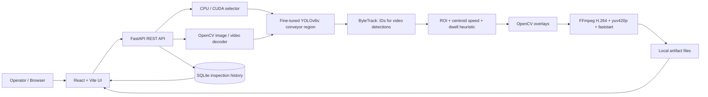

# ConveyorJam Watch

**Day 29 / 100 Days of Projects · Computer Vision · Manufacturing · Research Prototype**

> **Scope statement:** ConveyorJam Watch is an experimental visual-monitoring workstation that detects a **conveyor region**, tracks the detected region across sampled video frames, and flags prolonged low-motion observations using a configurable heuristic. **It does not yet recognize confirmed physical belt jams, material blockages, line stoppages, equipment defects, or safety incidents.** No validated real-jam ground truth or production deployment evaluation exists.

[Repository](https://github.com/MENSTRUE/ConveyorJam-Watch) · [API implementation](backend/app/main.py) · [Research report](reports/research/research_report.json) · [Detection evaluation](reports/evaluation/heldout_detection.json) · [Claim boundaries](reports/research/claim_boundaries.json)

## Table of contents

1. [Executive overview](#1-executive-overview)
2. [Before → Now → Next](#2-before--now--next)
3. [Source-of-truth hierarchy](#3-source-of-truth-hierarchy)
4. [Architecture and data flow](#4-architecture-and-data-flow)
5. [Features and honest status](#5-features-and-honest-status)
6. [Repository layout](#6-repository-layout)
7. [Datasets, provenance and licensing](#7-datasets-provenance-and-licensing)
8. [Data auditing and leakage risk](#8-data-auditing-and-leakage-risk)
9. [Training and selection methodology](#9-training-and-selection-methodology)
10. [Executed metrics and interpretation](#10-executed-metrics-and-interpretation)
11. [Video tracking and heuristic alert definition](#11-video-tracking-and-heuristic-alert-definition)
12. [Local environment and installation](#12-local-environment-and-installation)
13. [Running and using the application](#13-running-and-using-the-application)
14. [REST API contract](#14-rest-api-contract)
15. [Configuration and security considerations](#15-configuration-and-security-considerations)
16. [Reproducibility](#16-reproducibility)
17. [Testing and acceptance criteria](#17-testing-and-acceptance-criteria)
18. [Deployment readiness and production gaps](#18-deployment-readiness-and-production-gaps)
19. [Troubleshooting](#19-troubleshooting)
20. [Limitations, threats to validity, and claim boundaries](#20-limitations-threats-to-validity-and-claim-boundaries)
21. [Roadmap](#21-roadmap)
22. [FAQ](#22-faq)
23. [License, attribution, and responsible use](#23-license-attribution-and-responsible-use)
24. [References and contribution workflow](#24-references-and-contribution-workflow)

## 1. Executive overview

### The actual problem

Manufacturing and material-handling systems are often monitored through video feeds. Visual inspection is time-consuming, and meaningful machine-state signals can be lost among ordinary observations. This prototype explores how object detection, multi-object tracking, rule-based temporal signals, and a reviewable web UI might support operators **without asserting that a research heuristic is a verified fault detector**.

### Research question

Can a lightweight YOLO detector reliably localize the **conveyor class** in a specific labeled image domain, and can those predictions be fed into a reproducible tracking/visualization workflow that surfaces *candidate* prolonged-stationarity events for human examination?

**What this prototype produces:** labeled image/video previews, detections, track IDs where available, configurable dwell events, inspection history, research summaries, and media artifacts. It records *potential signals*, not measured jam frequency.

**Current stack:** YOLOv8 (Ultralytics), OpenCV, ByteTrack, FastAPI, Pydantic, SQLite, PyTorch (CPU/CUDA), FFmpeg/H.264, React 18, TypeScript, Vite, Recharts, Axios, and Lucide.

**Audience:** computer-vision researchers, manufacturing technologists, reviewers, and prospective contributors. **Not** a certified operator-assistance or safety-control system.

## 2. Before → Now → Next

| Phase | State | Evidence / interpretation |
|---|---|---|
| **Before** | Problem framing, collection of source-labeled iron-ore conveyor images and auxiliary tracking footage | Research provenance and inventory files |
| **Now: detector** | YOLOv8n and YOLOv8s compared; YOLOv8s selected by validation mAP50:95 | `reports/evaluation/validation_selection.csv`; `reports/research/research_report.json` |
| **Now: held-out source test** | 95 source-labeled test images, mAP50:95 ~0.9848 | `reports/evaluation/heldout_detection.json` — **not independent-video generalization** |
| **Now: demos** | ByteTrack/dwell-rule video outputs; three Kaggle demo videos and research timelines; a local React/FastAPI application | `reports/video_analysis/`, `assets/examples/`, `frontend/`, `backend/` |
| **Now: local runtime** | RTX 3050 Ti CUDA test confirmed; one local video processed, H.264 conversion tested | Local developer test only, not an automated repository benchmark |
| **Now: limitations** | No jam-labeled data; no independent industrial deployment, no measured alarm precision/recall | `reports/research/claim_boundaries.json` |
| **Next** | Jam annotation protocol, object-on-belt semantics, new source-video splits, negative data, external validation, safety hardening, CI/CD | [Roadmap](#21-roadmap) |

Status language matters: **implemented** means code exists; **executed** means an experiment or local run was observed; **validated** requires a matching ground-truth evaluation. These must not be conflated.

## 3. Source-of-truth hierarchy

When claims conflict, trust sources in this order:

1. **Executed, committed experiment artifacts:** `reports/research/research_report.json`, `reports/evaluation/heldout_detection.json`, `reports/evaluation/validation_selection.csv`, training experiment CSV, and source audit files. Preserve original values and units.
2. **Current implementation:** `backend/app/main.py`, `backend/tests/test_api.py`, `frontend/src/`, `frontend/package.json`, `backend/requirements.txt`.
3. **Original notebooks and model weights:** `notebooks/conveyorjam-watch.ipynb` (when supplied), `models/champion/conveyorjam_champion.pt` (local only; ignored by Git). Inspect notebook provenance before changing model claims.
4. **Run-specific local artifacts:** `backend/runtime/`, screenshots, unannotated test media. They establish only what was actually tested locally.
5. **Documentation:** this README, `AGENTS.md`, and `docs/`. Documentation explains evidence but must never override it.
6. **Future plans and hypotheses:** roadmap items are not shipped features or verified science.

**Reconciliation rule:** when a number is absent, use **Not measured / Not verified**, never 0%, 100%, or guessed data. A zero *event count* is not a zero *false-negative rate*.

## 4. Architecture and data flow



**Image path:** validate extension/size → decode → YOLO predict → overlay → save JPEG → write history → return artifact URL.

**Video path:** validate extension/size/duration parameters → save temporary upload → decode frames → stride sampling → YOLO `track(persist=True, tracker="bytetrack.yaml")` → ROI/centroid/dwell rule → write temporary `mp4v` → **release VideoWriter** → FFmpeg transcode to H.264 → verify file → save history → return playable video URL → remove temporary upload/intermediate files.

The output FPS is approximately input FPS divided by frame stride; it is **not** an original-frame-rate reconstruction. The `/api/v1/overview` observation total is a sum of detection observations, **not unique moving objects**.

### Critical semantic distinction

The trained class is **`conveyor`**. A conveyor's bounding box may remain stationary in the camera even while the belt moves normally. Therefore, a low-motion conveyor box can trigger a spurious jam-like signal. The heuristic must **not** be marketed as reliably detecting belt stoppages; a better system needs belt-surface motion, material tracking, ground truth, or physical sensors.

## 5. Features and honest status

| Feature | State | Grounded implementation / caveat |
|---|---|---|
| Command center | Implemented | `/api/v1/overview`; dashboard charts/history |
| Image detection | Implemented | `POST /api/v1/analyze/image`; conveyor-class bounding boxes |
| Video tracking | Implemented, local run observed | ByteTrack; frame stride; generated annotated video |
| Browser playback | H.264 backend fix in current GitHub code | FFmpeg required; regression test still recommended |
| CPU / NVIDIA GPU choice | Implemented | `/api/v1/devices`; CUDA requires appropriate PyTorch build |
| Monitor settings | Implemented, in process memory | `/api/v1/config`; settings reset on restart |
| ROI / speed / dwell | Implemented heuristic | Rule-only; not a validated fault label |
| Local inspection history | Implemented | SQLite; no authentication in prototype |
| Research/evidence page | Implemented | Should cite committed report, not substitute UI values |
| Verified real-jam detection | **Not available** | No labeled jam events |
| Live camera/RTSP reliability | **Not established** | Upload workflow is the implemented path |
| Industrial edge deployment | **Not established** | No SLAs, safety assessment, CI production gates |

## 6. Repository layout

The following reflects the **known GitHub repository plus locally expected, Git-ignored artifacts**. `(.gitignore)` marks local-only paths, not downloadable repository assets. Empty `.gitkeep` directories are not evidence of implementation.

```text
ConveyorJam-Watch/
├── README.md                     # project source-of-truth entry point
├── AGENTS.md                     # contributor / AI-agent rules
├── LICENSE                       # MIT for owned code
├── .env.example                  # placeholder; configure via environment
├── .gitignore
├── notebooks/                    # Kaggle executed notebook (check local copy)
├── models/
│   ├── baseline/                 # optional; may be empty
│   └── champion/
│       └── conveyorjam_champion.pt   # local, ignored; not in GitHub
├── reports/
│   ├── audit/                    # provenance, pairs, leakage-oriented checks
│   ├── evaluation/               # validation comparison, held-out detector metrics
│   ├── research/                 # report, claim boundaries, environment
│   ├── tests/                    # executed dwell scenarios
│   └── video_analysis/           # timelines, summaries, unverified events
├── assets/
│   ├── plots/video_alert_timeline.png
│   ├── examples/images/         # annotated evidence previews
│   ├── examples/videos/         # local-only annotated MP4 (ignored)
│   ├── examples/raw_images/     # optional local-only testing inputs
│   ├── examples/raw_videos/     # optional local-only testing inputs
│   ├── screenshots/             # screenshots; avoid private information
│   └── diagrams/                # diagrams, may be empty
├── docs/
│   ├── research/KAGGLE_OUTPUT_README.md
│   ├── en/                      # optional future translations
│   └── id/                      # optional future translations
├── backend/
│   ├── app/main.py              # actual FastAPI implementation
│   ├── tests/test_api.py
│   ├── requirements.txt
│   ├── README.md
│   └── runtime/                 # generated DB/media; SHOULD be ignored
├── frontend/
│   ├── src/{App.tsx,api.ts,main.tsx,styles.css}
│   ├── src/pages/{Overview,Inspect,History,Settings,Research}.tsx
│   ├── package.json
│   ├── package-lock.json
│   ├── tsconfig.json
│   ├── vite.config.ts
│   └── README.md
├── archives/                     # local ZIPs, ignored
└── gpu_patch_backup/             # legacy local backup; should not be in Git
```

**Repository hygiene warning (observed on GitHub, 2026-11-02):** `backend/runtime/history.sqlite3`, `backend/runtime/*_original_mp4v.bak`, and `gpu_patch_backup/` were tracked. They are runtime/backup artifacts, not canonical source. Remove them from *future tracking* with `git rm --cached` after making local backups and reviewing contents; `.gitignore` alone does not untrack committed content. Historical exposure is not undone by a normal commit; assess privacy/security before considering history rewriting. Do not automatically delete evidence files.

## 7. Datasets, provenance and licensing

The executed training used Kaggle input `/kaggle/input/datasets/loliwibu/conveyorjam-dataset`, with labeled iron-ore YOLO data under `iron-ore/yolo-dataset-center`. `data.yaml` defines exactly **one class: `conveyor`**. Source-provided images and bounding boxes are **not jam labels**.

| Source or role | Observed use | License state | Jam ground truth |
|---|---|---|---|
| Iron Ore Conveyor dataset | YOLO train/valid/test and iron-ore demos | **NOT_VERIFIED** in `source_provenance.csv` | None |
| Supervisely conveyor video | Ancillary tracking demonstration (man/bag) | **NOT_VERIFIED** | None |
| Camera-Based Conveyor Inspection Tracking | Reference code/output | **NOT_VERIFIED** | None |
| External Pexels/Pixabay tests | Optional developer-supplied media | License and attribution per each actual file | Not assumed |

The exact source-to-license relationship must be established **before redistributing any derived source footage, dataset, screenshots, or trained weights**. Public availability and free download do not themselves establish unrestricted commercial or redistribution rights. Cite source URLs, dataset versions, license text, acquisition date, and transforms in `reports/audit/source_provenance.csv` when verified. Do not silently replace `NOT_VERIFIED`.

**Provenance artifact checklist:** `dataset_inventory.csv`, `source_provenance.csv`, `train_pairs_manifest.csv`, `valid_pairs_manifest.csv`, `test_pairs_manifest.csv`, `sha_cross_split_audit.json`, `original_stem_overlap.json`, `annotation_errors.csv`, `orphan_labels.csv`, and `video_inventory.csv`.

## 8. Data auditing and leakage risk

The research report records the following source split:

| Split | Labeled images | Positive images | Boxes | Negative images |
|---|---:|---:|---:|---:|
| Train | 2,283 | 2,283 | 2,283 | 0 |
| Validation | 96 | 96 | 96 | 0 |
| Test | 95 | 95 | 95 | 0 |
| **Total** | **2,474** | **2,474** | **2,474** | **0** |

**Checks carried out:** paired image/label inspection, simple annotation audits, cross-split exact SHA matches (**0 detected**), and possible same-origin filename/stem groups (**0 detected**). These checks cannot exclude near-duplicates, common camera scenes, shared source videos, successive adjacent frames, temporal correlations, or visually redundant backgrounds. The report explicitly records `cross_video_independence_verified: false`.

**Missing evidence:** images without conveyors, other conveyors and material types, novel viewpoints, lighting changes, camera shake, different industrial sites, and human-labeled jam/non-jam event sequences. The all-positive test split means an image-level false-positive rate on conveyor-absent scenes is **not measurable** from it.

**Future split requirement:** group by the originating **video/session/camera/site** before model training; lock a genuinely external video/site holdout before candidate selection. Record duplicate detection (SHA and perceptual), dataset licenses, and class distributions.

## 9. Training and selection methodology

The executed notebook compared **YOLOv8n** and **YOLOv8s** under the recorded seed `42` and source-provided train/valid/test split. Reported training requests were 20 epochs for YOLOv8n and 15 for YOLOv8s; inspect the notebook logs for actual completed epochs and early stopping. Do not infer total training time or hardware from README.

Model selection used **validation mAP50:95**, not test metrics. Once selected, YOLOv8s was evaluated on the source-provided test split. This is methodologically better than selecting on test, but independence by original video is still unverified.

| Candidate | Validation mAP50 | Validation mAP50:95 | Validation precision | Validation recall |
|---|---:|---:|---:|---:|
| YOLOv8n | 0.995 | 0.989531 | 0.999441 | 1.000000 |
| **YOLOv8s (selected)** | **0.995** | **0.990524** | **0.999450** | **1.000000** |

The comparison is narrow (~0.000993 mAP50:95 difference), so cost/latency benchmarking and repeated-seed/independent-video comparisons are appropriate before claiming a practically meaningful advantage.

## 10. Executed metrics and interpretation

**Held-out source-image test for YOLOv8s (`reports/evaluation/heldout_detection.json`):**

| Metric | Observed |
|---|---:|
| Number of test images | 95 |
| mAP@IoU 0.50 | 0.9950 |
| mAP@IoU 0.50:0.95 | **0.9847654346** |
| Precision | 1.0000 |
| Recall | 1.0000 |
| Cross-video independence verified | **No** |

These are **bounding-box detection metrics for the `conveyor` class**, not jam classification, alert reliability, anomaly detection, fault prediction, or deployment accuracy. Perfect-looking precision/recall on a positive-only, potentially correlated test set deserve scrutiny, not a claim of an industrial breakthrough.

**Rule-engine synthetic scenarios:** `moving`, `brief_stop`, and `long_stop` each matched expected outcomes (3 of 3). This confirms test implementation for those scenarios, **not empirical jam recall or low false alarm rate**.

**Executed Kaggle demos:** `tracking_conveyor_annotated.mp4` (500 processed frames, ~25.26 processing FPS, 0 potential alerts; COCO pretrained demonstration); `iron_boardcamera_iron_ore_annotated.mp4` (980 frames, ~43.45 processing FPS, 1 potential alert); `iron_boardcamera_iron_ore_2_annotated.mp4` (998 frames, ~41.88 processing FPS, 1 potential alert). Reported values are **processing throughput in their original experiment environments**, not camera real-time capture FPS or the later Windows runtime. Two **potential** events in total are **unverified**. Read `reports/video_analysis/potential_jam_events_UNVERIFIED.csv` before any assertion about cause.

**Observed local demo, distinct from Kaggle evaluation:** a 16-second, 1920×1080 user-supplied conveyor video was processed on NVIDIA GPU; UI displayed 161 detection observations, zero potential flags, and ~34.2-second processing duration. A browser playback issue traced to OpenCV `mp4v` and was fixed in backend code via FFmpeg H.264. **One local run cannot establish throughput, FPS SLA, reliability, or jam recall.**

## 11. Video tracking and heuristic alert definition

For each sampled frame, YOLO produces bounding boxes. ByteTrack may assign track IDs. The DwellEngine computes each tracked box's center and estimates its displacement between observations using timestamp increments. It checks whether the centroid is inside a normalized ROI and whether the median of the last five speeds is below a pixel-per-second threshold for enough observations and elapsed dwell time.

Default configuration in the current backend:

```json
{
  "dwell_seconds": 3.0,
  "stationary_px_per_second": 12.0,
  "roi": [0.04, 0.08, 0.96, 0.94],
  "min_observations": 4,
  "lost_reset_seconds": 1.0
}
```

A rising event is recorded with `verified_jam: false`; it is not a signal that conveyor material has physically stopped. Track-ID switches, camera translation, ROI boundaries, partial occlusion, frame subsampling, variable FPS, and an immobile conveyor box can confound speed/dwell. Config values are stored **in memory** and reset after process restart. A video analysis uses a snapshot of the config at its start.

## 12. Local environment and installation

Recommended development setup: Windows 11, Python 3.11 (match the chosen PyTorch wheel), Node/npm supported by Vite 6, FFmpeg available on PATH, and optionally an NVIDIA CUDA-capable GPU. Exact version compatibility is environment-dependent; use `pip check`, a frontend build, and hardware validation rather than assuming all versions work.

**Git:**

```powershell
git clone https://github.com/MENSTRUE/ConveyorJam-Watch.git
cd ConveyorJam-Watch
```

**Local model prerequisite:** place the trained `conveyorjam_champion.pt` at `models/champion/conveyorjam_champion.pt`, or set `CONVEYOR_MODEL` to an existing model path. Git intentionally does not store `.pt` files. If the artifact is unavailable, `/api/v1/health` may still respond but model-based inference returns 503.

**Backend:**

```powershell
python -m venv .venv
.\.venv\Scripts\python -m pip install -r backend\requirements.txt
.\.venv\Scripts\python -m pip check
ffmpeg -version
.\.venv\Scripts\python -m uvicorn app.main:app --app-dir backend --reload --host 127.0.0.1 --port 8000
```

**Frontend (new terminal):**

```powershell
cd frontend
npm ci
npm run dev
```

Open `http://127.0.0.1:5173`; API docs `http://127.0.0.1:8000/docs`. Do not expect `npm run dev` to build a production bundle; run `npm run build` for that check.

**CUDA:** installing the NVIDIA driver alone does not mean PyTorch has CUDA support. A previously executed local environment used `torch 2.10.0+cu128` and `torchvision 0.25.0+cu128` with an RTX 3050 Ti Laptop GPU. Select a PyTorch CUDA build compatible with your Python, OS, and driver from the official PyTorch installation guide. Do not blindly replace dependencies in a working environment.

```powershell
.\.venv\Scripts\python -c "import torch; print(torch.__version__, torch.version.cuda, torch.cuda.is_available()); print(torch.cuda.get_device_name(0) if torch.cuda.is_available() else 'CPU only')"
```

CPU remains a supported execution mode. For 4-GB VRAM devices, close competing GPU workloads and start with short media; the current inference path uses image size 640 and a video frame stride default of 3.

## 13. Running and using the application

1. Start FastAPI and Vite in separate terminals; confirm `/api/v1/health` and `/api/v1/devices`.
2. Open **Visual inspection**; select Image detection or Video tracking.
3. Choose **Auto**, **CPU**, or **NVIDIA GPU** (only when backend detects CUDA).
4. Upload **unannotated** raw media for a functional test. Annotated Kaggle previews already contain burned-in boxes and are not independent raw input.
5. For video, start with a short clip, conservative `max_seconds`, and moderate frame stride. The current limit is 150 MB and 60 s (environment-controlled); UI file size guidance may differ.
6. View bounding boxes and flags, then inspect **Analysis archive** and video playback. Inspect actual video codec if HTML5 playback fails.
7. Treat any flag as a **review candidate**. A zero flag count does not imply zero faults.

The uploaded file must be copied into the local testing folder if you want to keep a reproducible developer sample. Do not commit third-party unlicensed videos or sensitive footage.

## 14. REST API contract

| Method | Endpoint | Function |
|---|---|---|
| GET | `/api/v1/health` | Service, model file, device, compute capabilities |
| GET | `/api/v1/devices` | Current selection, effective CPU/CUDA, available options |
| POST | `/api/v1/devices` | JSON `{ "device": "auto" | "cpu" | "cuda:0" }` |
| GET | `/api/v1/config` | Current in-memory dwell/ROI settings |
| POST | `/api/v1/config` | Replace validated monitor settings |
| GET | `/api/v1/overview` | Aggregate local count and activity timeline |
| GET | `/api/v1/history?limit=30` | Recent analyses (capped at 100) |
| DELETE | `/api/v1/history` | Delete database history rows **only**; generated files stay |
| GET | `/api/v1/artifacts/{filename}` | Serve generated JPG/MP4 inline |
| POST | `/api/v1/analyze/image` | Multipart `file`; detects conveyor and returns annotated JPG URL |
| POST | `/api/v1/analyze/video` | Multipart `file`, `max_seconds` (default 25), `frame_stride` (default 3); returns annotated H.264 MP4 URL |

Example command:

```powershell
curl.exe http://127.0.0.1:8000/api/v1/health
curl.exe -X POST http://127.0.0.1:8000/api/v1/devices -H "Content-Type: application/json" -d '{"device":"auto"}'
curl.exe -X POST http://127.0.0.1:8000/api/v1/analyze/image -F "file=@assets/examples/raw_images/conveyor_test.jpg"
```

Caution: PowerShell quoting of JSON with `curl.exe` varies. Use `Invoke-RestMethod` with `ConvertTo-Json` if the above device command is interpreted incorrectly. Prefer Swagger `/docs` when manually testing multipart uploads. API request/response field details should be verified against live OpenAPI; the Python source is authoritative.

## 15. Configuration and security considerations

| Environment variable | Default | Meaning |
|---|---|---|
| `CONVEYOR_MODEL` | `models/champion/conveyorjam_champion.pt` | Model weights path |
| `CONVEYOR_DATA_DIR` | `backend/runtime` | Generated media and SQLite folder |
| `MAX_IMAGE_MB` | `16` | Image upload size cap |
| `MAX_VIDEO_MB` | `150` | Video upload size cap |
| `MAX_VIDEO_SECONDS` | `60` | Max requested analysis seconds |
| `CONVEYOR_CONF` | `0.25` | YOLO inference confidence |
| `FRAME_STRIDE` | `3` | Default video frame sampling interval |
| `YOLO_DEVICE` | `auto` | `auto`, `cpu`, or `cuda:0` initial selection |
| `CORS_ORIGINS` | localhost/127.0.0.1 port 5173 | Allowed browser origins |

`.env.example` is a template **if populated**; the checked GitHub version was empty. The backend directly reads process environment variables; it does **not** automatically call `load_dotenv()`. Set values explicitly in the launching shell or implement secure environment loading.

**Security limitations that block deployment:** no authentication or authorization on inspection/history/config APIs; no user-specific storage separation; untrusted uploads are processed using multimedia decoders; SQLite access and model execution are local-process scoped; no rate limits or resource quotas beyond basic upload/duration checks; no security event log; CORS is not an access-control mechanism; history deletion is unauthenticated. Run only on trusted local loopback for experiments. Avoid public `0.0.0.0` exposure. Implement authentication, upload isolation, malware/content validation, API quotas, privacy policy, retention, resource monitoring, and secrets management before network or cloud access.

## 16. Reproducibility

The original training evidence is the committed research report and Kaggle notebook; the live app alone does not reproduce training. Use original dataset versions, explicit source provenance, exact train/valid/test manifests, notebook revision, seed 42, package versions, and selected weights. `source_provenance.csv` currently has unverified license fields; update only after primary-source verification.

**Minimum reproducible sequence:**

1. Acquire the original data under an authorized license; validate image-label pairs and class index `0=conveyor`.
2. Audit metadata, dimensions, annotation ranges, duplicates, class distributions and source-video identities.
3. Respect the original data split for reproducing Kaggle results; for a **new** scientific benchmark, predefine video/site-separated splits before training.
4. Run training comparison YOLOv8n/YOLOv8s as recorded, fixing seed and documenting hardware/dependencies.
5. Select based on **validation mAP50:95** only; lock checkpoint.
6. Evaluate the untouched designated test once, per class and confidence/calibration; disclose source independence limitations.
7. Test tracker and dwell logic separately with synthetic paths and real event-labeled video.
8. Export weights, logs, manifests, precision/recall/AP plots, config, and model card. Provide hashes for large local-only artifacts.
9. Run local API and video encoding acceptance tests. Test HTTP range delivery/playback through a real browser.

A GitHub clone by itself cannot reproduce model inference because the trained `.pt` is ignored. Avoid asserting the weights are freely downloadable from GitHub. Archive the authorized source notebook and a manifest, not third-party media without permission.

## 17. Testing and acceptance criteria

**Existing backend unit tests** (`backend/tests/test_api.py`) cover health response, config roundtrip/invalid ROI, history type, missing-model 503, and a synthetic dwell-positive case. The source experiment separately reports synthetic moving/brief-stop/long-stop outcomes. They are not production acceptance tests.

Run:

```powershell
.\.venv\Scripts\python -m pytest backend\tests -q
.\.venv\Scripts\python -m pip check
cd frontend
npm ci
npm run build
```

*Potential caveat:* tests adjust module global environment/model state and may create `backend/tests/.runtime_test`; keep generated test storage out of Git. Do not report CI green until tests execute successfully in a clean environment.

**Manual acceptance matrix:** (a) image detection 200 + readable annotated JPEG + history record; (b) video analysis 200 + `ffprobe` reports H.264 (`codec_name=h264`) and >0 duration; (c) video plays in Edge/Chrome with seek support; (d) CPU and CUDA selections report accurate effective device; (e) invalid file returns 4xx, oversize returns 413; (f) missing weights returns 503; (g) invalid ROI returns 422; (h) no artifact/history corruption after decode or FFmpeg failure; (i) no third-party source data or local runtime leaked in `git status`.

```powershell
ffprobe -v error -select_streams v:0 -show_entries stream=codec_name,pix_fmt,width,height -show_entries format=duration -of json backend\runtime\YOUR_OUTPUT.mp4
```

## 18. Deployment readiness and production gaps

**Current status: NOT DEPLOYMENT READY.** The local app is a researcher-facing demo, not a monitored industrial service. Production design would require (i) authentic, independent jam/non-jam events and operating states; (ii) meaningful object/material/belt motion measurement; (iii) site-specific data validation; (iv) multi-camera robustness and drift monitoring; (v) per-device calibration; (vi) false alarm/missed alarm costs, confidence and human acknowledgement; (vii) worker privacy and footage retention controls; (viii) authentication, audit trails, retries, queues, and storage lifecycle; (ix) performance SLAs under real workloads; (x) fail-safe control boundaries; and (xi) licensing/legal approval.

**Never connect heuristic events to emergency-stop or machinery actuation.** Any industrial safety system requires separate engineering, validated sensors, applicable standards, risk assessments, and qualified personnel.

## 19. Troubleshooting

| Symptom | Likely cause | Check / remedy |
|---|---|---|
| `CUDA Available: False` | CPU-only PyTorch or driver/runtime mismatch | `python -c "import torch; print(torch.__version__, torch.version.cuda, torch.cuda.is_available())"`; use official CUDA wheel compatible with environment |
| `Model missing` / 503 | `.pt` intentionally excluded from Git | Verify `models/champion/conveyorjam_champion.pt` or `CONVEYOR_MODEL` |
| Video upload succeeds but output 0:00 / won't play | OpenCV `mp4v` unsupported by browser, incomplete MP4, or media HTTP issue | Current backend transcodes after writer close; check `ffmpeg -version`, `ffprobe`, Network tab, actual artifact URL |
| FFmpeg failed / missing | `ffmpeg` absent or no `libx264` | Confirm `ffmpeg -encoders` contains `libx264`; inspect error, never return incomplete output |
| `nvidia-smi` works but `torch.cuda` false | Driver presence ≠ CUDA-enabled PyTorch | Check `torch.__version__` suffix and `torch.version.cuda` |
| CUDA OOM | 4-GB VRAM or competing applications | Close other GPU tasks, shorten video, lower GPU load; `imgsz=640` currently hardcoded in backend |
| 0 detections | Domain shift, low confidence, missing conveyor, wrong input | Check raw unannotated input and class semantics; not evidence of no jam |
| 0 flags | Dwell threshold not reached or no valid track | Examine ROI, track IDs, sampled FPS and config; cannot conclude fault-free |
| Too many flags | Stationary conveyor bbox, miscalibration | Adjust rule only for exploratory visualization; need jam ground truth before measuring quality |
| `localhost:5173` has no data | API not started or browser request failure | Start uvicorn, check `/health`, browser console, CORS and Vite proxy |
| `git add` includes runtime or backup | Already tracked files bypass ignore | Review `git ls-files backend/runtime gpu_patch_backup`; use `git rm --cached` carefully, never delete local evidence by mistake |
| Visual result has preexisting boxes | Source is already annotated | Test with truly raw unannotated media |
| Slow inference | Resolution, CPU/GPU competition, frame size, FFmpeg conversion | Compare GPU availability, `processed_frames`, wall clock, and source/output FPS; don't use notebook throughput as local SLA |

## 20. Limitations, threats to validity, and claim boundaries

### Allowed evidence-based language

- "YOLOv8s achieved **0.9848 mAP50:95** on **95 source-labeled conveyor test images**, under an **unverified cross-video independence** assumption."
- "A locally run pipeline generated annotated video and processed conveyor detection observations with an NVIDIA CUDA-enabled PyTorch installation."
- "An ROI/centroid/dwell heuristic generated **two potential, unverified** alert events across the recorded Kaggle iron-ore demos."
- "ConveyorJam Watch is an **experimental monitoring and review tool**."

### Prohibited or unsupported claims

- "99% jam detection accuracy," "100% industrial reliability," "zero false alarms," or "real-time guaranteed."
- "The model detects stopped belts, blocked material, dangerous jams, conveyor failure, or imminent breakdown" without corresponding detector classes and independent event labels.
- "Cross-camera generalization proven" or "no leakage" based solely on hashes and filename matching.
- "AI automatically controls safety operations" or "deployment ready."
- "All dataset licenses are open / commercial use permitted" without verified terms.
- "161 unique objects tracked" when 161 refers to **detection observations**.

The reported AP metrics have no documented uncertainty bounds for independent sites. Jam-event precision, recall, macro-F1, false-positive rate, time-to-detection, and lead-time are **not available**. Never fabricate them.

## 21. Roadmap

| Priority | Initiative | Definition of done |
|---|---|---|
| P0 | Repository hygiene | Untrack SQLite, runtime backups, temporary media; verify clean `.gitignore` and review history exposure |
| P0 | Browser playback regression | Automated/recorded H.264 video generation and browser seek/play check |
| P0 | Documentation & artifact ledger | Verifiable hashes, provenance URLs, model card, reproduction steps; identify local-only assets |
| P1 | Robust test media | Independent, legal, unannotated videos, negative examples, annotation instructions |
| P1 | Semantics and ground truth | Define physical jam vs stoppage vs empty belt; annotate start/end and severity with reviewer agreement |
| P1 | Stronger baseline | Track **material/belt motion**, optical flow, object dwell, optional sensor timestamps; compare simple baselines |
| P1 | Group-disjoint re-evaluation | Site/video separation, no repeated test tuning, negative and hard-negative cohorts |
| P1 | Explainable review UX | Explicit heuristics, ROI, confidence and event provenance; human accept/reject |
| P2 | Runtime resilience | Queue jobs, cancellability, bounded GPU memory, persistent configs, retention settings |
| P2 | Security & observability | Authentication, rate limiting, upload sandboxing, metrics and trace IDs |
| P2 | Deployment packaging | Docker/Compose, reproducible environment, CI/CD, role-based access, license check |
| P3 | Site pilot | Controlled opt-in industrial pilot with independently measured false alarms, detection times and workflow usability |

Do not mark roadmap items complete based on a mock interface, generated code, or a single successful local execution.

## 22. FAQ

**Q: Does the model detect a jam?**  
A: No verified jam detector exists. It detects a single `conveyor` class and emits heuristic low-motion candidates.

**Q: Why are detection AP scores nearly perfect?**  
A: The source test contains only 95 positives and no negative images; common scene/video origins and near-duplicates have not been ruled out. The score is genuine recorded output but not evidence of real-world transfer.

**Q: What is the difference between a bounding box and a tracked object?**  
A: A box is one detection on one frame. ByteTrack may associate boxes across frames via a track ID. Observations are not necessarily unique physical entities.

**Q: Does a zero-alert video mean the conveyor is healthy?**  
A: No. The heuristic may miss conditions, and the target event has no validated label set.

**Q: Why is the `.pt` model missing after cloning?**  
A: Model weights are intentionally Git-ignored. Obtain them from an authorized archived training output and place them locally.

**Q: Can I use GPU?**  
A: Yes when `torch.cuda.is_available()` is true and the backend reports the GPU. CPU and Auto modes are also supported.

**Q: Why does `nvidia-smi` show a GPU while PyTorch doesn't?**  
A: Drivers and the PyTorch CUDA wheel are independent components. A `+cpu` PyTorch build cannot run CUDA inference.

**Q: Why won't an MP4 open in my browser?**  
A: `.mp4` is a container; codec matters. Native `mp4v` video can be incompatible with browsers. The current backend transcodes to H.264/yuv420p/faststart with FFmpeg.

**Q: Can I publish source videos and trained weights?**  
A: Not until source license/redistribution/derivative-model terms are checked per source. MIT on original code doesn't license upstream footage.

**Q: Is this ready for factory operations?**  
A: No. It is a local research prototype requiring validated ground truth, security, safety review, and field evaluation.

**Q: What does `DELETE /history` remove?**  
A: SQLite history rows, not stored media artifacts; handle retention separately.

**Q: Is tracking FPS the same as camera FPS?**  
A: No. The app samples frames and reports processing throughput separately from source and output FPS.

**Q: Are the annotated preview videos good model tests?**  
A: They're useful as evidence of past processing but unsuitable as raw independent test media. Prefer unannotated, non-overlapping source videos.

## 23. License, attribution, and responsible use

The repository's existing `LICENSE` file is **MIT License**, copyright **2026 wafa bila syaefurokhman**. This applies to original project code and documentation that the author may license; **it does not automatically grant rights** to third-party datasets, model components, source video, graphics, trademarks, or redistributed assets. The source provenance audit marks upstream licenses `NOT_VERIFIED`. Follow the upstream licenses for Ultralytics, its dependencies, and any external resources; verify the licensing implications of incorporating Ultralytics in commercial systems separately.

For any release: include source-specific attribution, dataset links, version identifiers, license notices, usage restrictions, model provenance, non-commercial exclusions if any, and redistribution approval. Do not present model weights or derived footage as MIT-licensed by default.

No warranty; no automated operational safety or life-critical use. Only process footage with appropriate authorization and personal-data safeguards.

## 24. References and contribution workflow

**Internal primary evidence:**

- [`reports/research/research_report.json`](reports/research/research_report.json)
- [`reports/evaluation/heldout_detection.json`](reports/evaluation/heldout_detection.json)
- [`reports/evaluation/validation_selection.csv`](reports/evaluation/validation_selection.csv)
- [`reports/research/claim_boundaries.json`](reports/research/claim_boundaries.json)
- [`reports/audit/source_provenance.csv`](reports/audit/source_provenance.csv)
- [`reports/tests/dwell_unit_tests.csv`](reports/tests/dwell_unit_tests.csv)
- [`docs/research/KAGGLE_OUTPUT_README.md`](docs/research/KAGGLE_OUTPUT_README.md)
- [`backend/app/main.py`](backend/app/main.py)

**External project references:** [Ultralytics YOLO](https://docs.ultralytics.com/), [ByteTrack](https://github.com/ifzhang/ByteTrack), [FastAPI](https://fastapi.tiangolo.com/), [PyTorch](https://pytorch.org/), [OpenCV](https://opencv.org/), [FFmpeg](https://ffmpeg.org/), [React](https://react.dev/), [Vite](https://vite.dev/).

Read [`AGENTS.md`](AGENTS.md) before modifying code, research assertions, datasets, or exports. Prefer focused PRs with tests, explicit before/after outcomes, and no unsupported performance claims.

---

*Document snapshot: 2026-11-02. Grounded in inspected GitHub default-branch files and separately observed local run logs. This document describes evidence and known implementation; it does not certify production readiness.*

## Documentation library (complete Markdown pack)

See [`docs/README.md`](docs/README.md) for **all Markdown documents**: backend and frontend guides, architecture, experimental provenance, testing, deployment, troubleshooting, contribution rules, English index and Indonesian guide. Current root `README.md` and `AGENTS.md` remain the top-level source-of-truth entry points.
