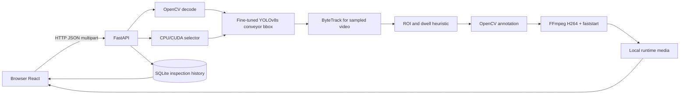

# Architecture and Data Contracts

## Logical view

The detector predicts the *conveyor* box, not payload movement or jam state. Centroid-based stationary dwell is only a candidate signal. Browser videos derive from a per-request FFmpeg conversion after the writer has been released; model operations are serialized via a process-level lock. This is a single-process local prototype; process-global device/config state and SQLite are not multi-worker safe as a coordinated operational service.

## API boundaries

- Inbound media: validated extension and decoded image/video; size and dimensions constrained but content remains untrusted.
- Image: `POST /api/v1/analyze/image` → JPEG artifact, detection metadata, persisted row.
- Video: `POST /api/v1/analyze/video` → sampled detections, tracker, heuristic events, finalized H.264 artifact, persisted row.
- Result: analysis id, timestamp, kind, counts, flags, timing, artifact URL; server is authoritative for filenames.
- Persisted metadata: SQLite; no tenant partitioning. Runtime data is not a dataset provenance record.

## Correctness invariants

1. Model must be found at configured path; never silently substitute another model.
2. `FileResponse` serves only controlled artifact filenames and supported output extensions.
3. Every video output is finalized, transcoded, verified nonempty *before* history is committed.
4. One tracking request must not reuse another request's ByteTrack state.
5. Threshold tuning never changes research metrics for the frozen source experiment.
6. Device selection is an explicit operational choice; CUDA availability is measured, not inferred.

## Future architecture

For network-facing operation: task queue; background workers; job state machine; idempotency; authenticated object storage; signed playback URLs; streaming rather than entire-file memory upload; authenticated API; immutable event audits; telemetry, alert labeling, failure recovery; per-tenant settings. These are **planned, not implemented**.
